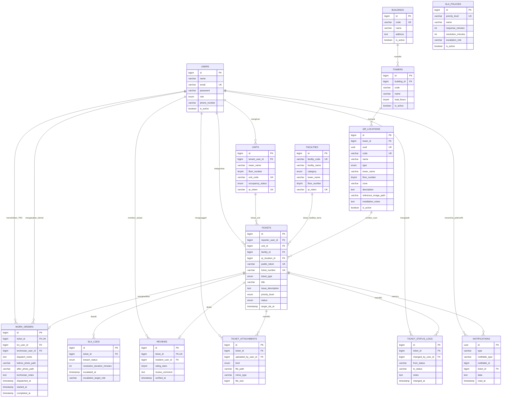

# ERD APART-CARE

Diagram ini menggambarkan skema domain operasional. Tabel infrastruktur Laravel seperti `cache`, `jobs`, `sessions`, dan `password_reset_tokens` tidak ditampilkan agar relasi bisnis tetap terbaca.

## Catatan desain

- `qr_locations.uuid` adalah identitas publik dalam URL dan tidak berubah setelah label dibuat.
- `qr_locations.code` adalah kode pendek yang dicetak di bawah QR sebagai jalur manual ketika kamera gagal.
- `reference_image_path` menampilkan foto/ilustrasi objek agar pelapor dapat memverifikasi lokasi sebelum mengirim laporan.
- `ticket_status_logs` menyimpan audit transisi status, sedangkan `sla_logs` menyimpan hasil evaluasi SLA.
- `ticket_attachments` memungkinkan lebih dari satu bukti foto tanpa menghilangkan kolom kompatibilitas pada tiket dan work order.
